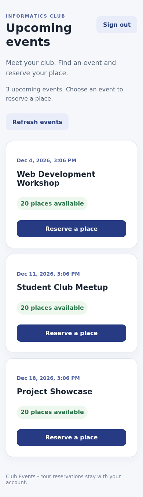
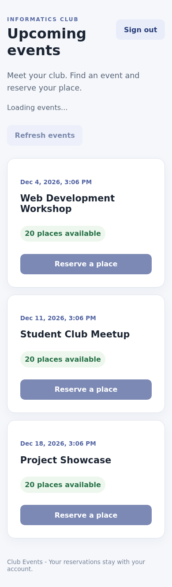
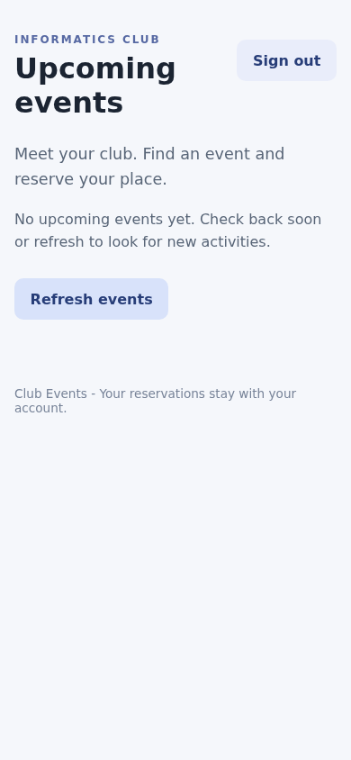
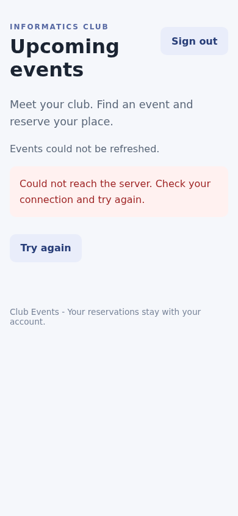
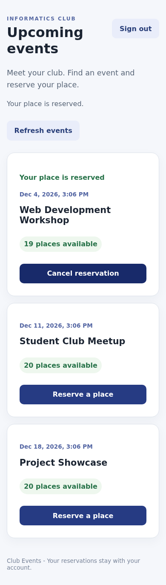
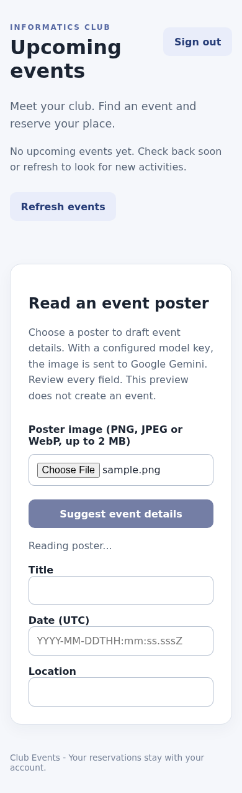
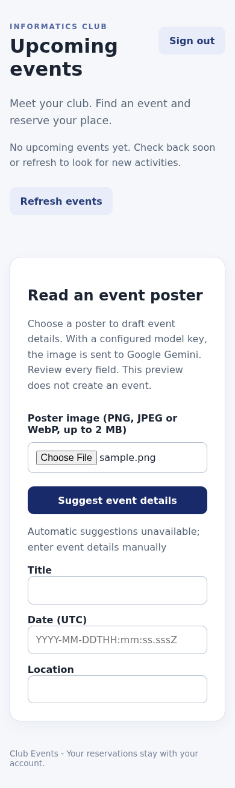

# UI checklist

<!-- Exercise 4 hands this in. Tick an item only when you have checked it, and replace
     the "how I checked" line with what you actually did. An unticked box is not a
     failure: it is a gap you then write into READINESS.md. A ticked box you cannot
     demonstrate at the defence is worse than an unticked one. -->

"Modern" is not a style. It is a short list of things a user notices when they are
missing: the screen tells you what is happening, you can get through it with a keyboard,
the text is readable, and nothing jumps around while it loads.

## Layout and typography

- [ ] **One spacing scale and one type scale.** Sizes come from a small set of design tokens, not from numbers typed where they were needed.
  - how I checked: Not measured; no spacing or type-token inventory was recorded.
- [ ] **Responsive at 380, 768 and 1280 pixels wide.** No horizontal scrollbar, no text running under another element.
  - how I checked: The login page had no horizontal overflow at 1363 CSS pixels; the required 380, 768 and 1280 widths were not checked.
- [ ] **Nothing jumps while the page loads.** Images and cards reserve their space before their content arrives.
  - how I checked: Not checked with a layout-shift measurement or a before/after capture.

## The four states, on every screen

A screen that only handles "it worked" is a screen that lies to the user on the day it matters.

- [ ] **Loading.** Something tells the user the app is working, within about 100 ms.
  - how I checked: A test-only gated events request showed the visible Loading events... state, captured in [events-loading.png](ui/events-loading.png). On the live page I also saw Loading events... before the list arrived. I did not measure the loader timing, so the 100 ms criterion remains unverified.
- [x] **Empty.** The screen says what this list is for and what to do next, instead of showing nothing.
  - how I checked: Removed all events from the isolated browser-test database, refreshed, and verified the empty guidance text in [events-empty.png](ui/events-empty.png).
- [x] **Error.** A sentence a person can read. Never a raw JSON body, never a stack trace, never just "Error".
  - how I checked: Simulated an offline events request, verified the readable message and retry button, then retried successfully; [events-error.png](ui/events-error.png) records the error state.
- [x] **Success.** The user can see that what they did took effect, without reloading the page to find out.
  - how I checked: In the isolated browser test, reserved a place, verified the inline success message and the database row changed from 0 to 1, then captured [events-success.png](ui/events-success.png). On the live Render site I reserved Project Showcase and saw the inline success message; after a deploy and rollback, the same reservation remained visible.

## Keyboard and accessibility

- [ ] **The main flow works with the keyboard alone.** Sign in, do the core action, sign out, without touching the mouse.
  - how I checked: Only keyboard focus on the login form was checked; the complete sign-in, reserve and sign-out flow was not run by keyboard alone.
- [x] **The focused element is visible.** A `:focus-visible` outline that is not switched off.
  - how I checked: On the forwarded HTTPS login page, the password field showed `:focus-visible` with a solid 3-pixel outline.
- [ ] **Text contrast is at least 4.5:1.** Name the tool you measured with.
  - how I checked: No contrast ratio was measured.
- [ ] **Every input has a label** a screen reader reads, not just placeholder text.
  - how I checked: The login email and password inputs had associated labels; the whole app was not audited with a screen reader.
- [x] **The page has a correct `<title>` and `lang`.**
  - how I checked: On the login page, the browser showed title `Sign in | Club Events` and `lang="en"`; the events page was not checked live.
- [ ] **Touch targets are at least 44 pixels.**
  - how I checked: Touch-target dimensions were not measured.

## The model feature

- [x] **It shows that it is thinking.** A model call is slow and a free service may have been asleep; a frozen button is the worst possible answer.
  - how I checked: Held the poster-suggestions request in the browser test and captured the visible Reading poster... state in [model-thinking.png](ui/model-thinking.png). This verifies the state, not the real provider latency.
- [x] **It shows when it failed,** and the rest of the screen still works.
  - how I checked: Let the browser test request continue to the unconfigured provider, verified the readable unavailable message, filled the manual title field, and captured [model-failing.png](ui/model-failing.png).
- [ ] **The user can tell the model's suggestion from a fact.** It is labelled as a suggestion, not presented as data the app knows.
  - how I checked: Not demonstrated with a successful model suggestion.

## Decisions

- [x] **Dark mode, or a written decision not to have one.**
  - what I decided and why: Keep one light theme for this exercise so the work can focus on readable event and reservation states; there is no dark-mode preference in the current app. This is a scope decision, not a contrast claim.

## Evidence

<!-- Screenshots of at least the four states of one screen, and of the model feature
     thinking and failing. A link to them is enough; they do not have to be in the repo. -->

Browser screenshots were generated by node --test browser-tests/ui.test.browser.mjs:

- Event list content: [events-content.png](ui/events-content.png)
- Event list loading: [events-loading.png](ui/events-loading.png)
- Event list empty: [events-empty.png](ui/events-empty.png)
- Event list error: [events-error.png](ui/events-error.png)
- Reservation success: [events-success.png](ui/events-success.png)
- Model request thinking: [model-thinking.png](ui/model-thinking.png)
- Model request unavailable fallback: [model-failing.png](ui/model-failing.png)

## Captured UI screenshots

